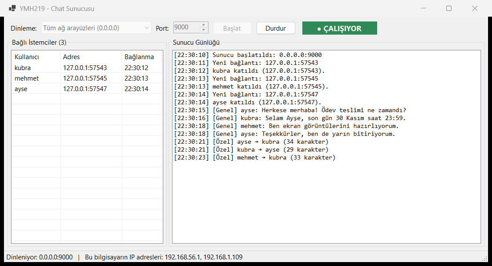

# YMH219 - Chat Uygulaması

Nesne Tabanlı Programlama (YMH 219) dersi için C# ve Windows Forms ile geliştirilmiş istemci-sunucu sohbet uygulaması. Sunucu `TcpListener` ile bağlantıları kabul eder; istemciler `TcpClient` ile bağlanıp kullanıcı adıyla sohbete katılır. Aynı bilgisayarda veya aynı yerel ağdaki (LAN) bilgisayarlar arasında çalışır.

## Özellikler

**Sunucu**
- Seçilen port üzerinden dinlemeye başlama / durdurma (tüm ağ arayüzleri veya yalnızca bu bilgisayar)
- Bağlı istemcilerin listesi: kullanıcı adı, IP adresi:port ve bağlanma saati
- Zaman bilgili sunucu günlüğü (bağlanma, katılma, ayrılma, genel mesajlar, özel mesaj bildirimleri, hatalar)
- Durum çubuğunda bilgisayarın yerel IP adresleri (LAN'dan bağlanacak istemciler için)
- Aynı kullanıcı adının (büyük/küçük harf duyarsız) ikinci kez kullanılmasını engelleme
- Kullanıcı adını 10 saniye içinde göndermeyen, geçersiz veri gönderen veya mesajları okumayan bağlantıları kapatma
- Kullanımda olan port gibi hatalarda programı kapatmadan uyarı gösterme

**İstemci**
- Sunucu adresi, port ve kullanıcı adı ile bağlanma; bağlantıyı kesme
- Gönderilen ve alınan mesajların saat bilgisiyle gösterimi (zaman damgası sunucuda atanır)
- Çevrimiçi kullanıcı listesi ve katılma/ayrılma bildirimleri
- **Özel mesaj:** "Alıcı" listesinden kullanıcı seçerek veya çevrimiçi listesinde kullanıcıya çift tıklayarak yalnızca o kişiye mesaj gönderme
- **Geçmişi kaydetme:** ekrandaki tüm mesajları tarih ve saatleriyle `.txt` dosyasına kaydetme
- Enter tuşu ile mesaj gönderme, her kullanıcı için farklı isim rengi
- Bağlantı hatalarında (sunucu kapalı, adres bulunamadı, zaman aşımı, kullanıcı adı alınmış vb.) açıklayıcı uyarı; sunucu kapanırsa veya bağlantı koparsa programın çökmeden bağlı değil durumuna geçmesi

## Kullanılan Teknolojiler

- C# / .NET 9
- Windows Forms (arayüz kodla oluşturulmuştur, Designer kullanılmamıştır)
- `System.Net.Sockets`: `TcpListener`, `TcpClient`, `NetworkStream`
- `StreamReader` / `StreamWriter` ile satır tabanlı iletişim
- `async` / `await`, `CancellationToken` ve hata yönetimi (`try`/`catch`, özel `ChatException`)
- `System.Text.Json` ile mesajların JSON olarak serileştirilmesi

## Proje Yapısı

```
YMH219-ChatApp/
├── ChatApp.Core/          Ağ ve mesaj mantığı (arayüzden bağımsız sınıf kütüphanesi)
│   ├── ChatServer.cs      TcpListener, istemci oturumları, mesaj dağıtımı
│   ├── ChatClient.cs      TcpClient ile bağlanma, okuma döngüsü, mesaj gönderme
│   ├── MessageChannel.cs  StreamReader/StreamWriter ile satır okuma/yazma
│   ├── ChatMessage.cs     Protokol mesajı (MessageType.cs ile birlikte)
│   ├── MessageSerializer.cs, UserNameRules.cs, ChatHistory.cs, ClientInfo.cs, ChatException.cs
├── ChatApp.Server/        Sunucu uygulaması (ServerForm)
├── ChatApp.Client/        İstemci uygulaması (ClientForm)
└── docs/screenshots/      Ekran görüntüleri
```

### Mesaj Protokolü

Her mesaj tek satırlık bir JSON nesnesi olarak gönderilir:

```json
{"Type":"Chat","From":"kubra","Text":"Merhaba!","Timestamp":"2026-11-11T22:30:16+03:00"}
```

| Tür | Yön | Açıklama |
| --- | --- | --- |
| `Join` / `Accept` / `Reject` | İstemci ↔ Sunucu | Kullanıcı adıyla katılma isteği ve yanıtı |
| `Chat` | İki yönlü | Herkese açık mesaj |
| `Private` | İki yönlü | Yalnızca alıcıya (ve gönderene kopya) iletilen özel mesaj |
| `UserList`, `UserJoined`, `UserLeft` | Sunucu → İstemci | Çevrimiçi kullanıcı bilgileri |
| `System` | Sunucu → İstemci | Bilgi / hata bildirimi |
| `Leave` | İstemci → Sunucu | Bağlantıyı düzgün kapatma |

Gönderen adı ve mesaj zamanı sunucu tarafından atanır; böylece bir istemci başka biri adına mesaj gönderemez.

## Çalıştırma Adımları

1. [.NET 9 SDK](https://dotnet.microsoft.com/download) kurulu olmalıdır (Windows).
2. Depoyu klonlayın:
   ```bash
   git clone https://github.com/kubradmrgc/YMH219-ChatApp.git
   cd YMH219-ChatApp
   ```
3. Sunucuyu başlatın ve pencerede **Başlat** düğmesine tıklayın (varsayılan port 9000):
   ```bash
   dotnet run --project ChatApp.Server
   ```
4. Her istemci için ayrı bir terminalde istemciyi çalıştırın:
   ```bash
   dotnet run --project ChatApp.Client
   ```
5. İstemcide sunucu adresini (aynı bilgisayarda `127.0.0.1`), portu ve kullanıcı adını girip **Bağlan** düğmesine tıklayın.

**Yerel ağda (LAN) kullanım:** Sunucuda "Tüm ağ arayüzleri (0.0.0.0)" seçili olmalıdır. İstemcide sunucu adresi olarak sunucu penceresinin durum çubuğunda görünen IP adresini (ör. `192.168.1.109`) yazın. Windows Güvenlik Duvarı ilk çalıştırmada izin isteyebilir; özel ağlar için izin verilmelidir.

**Kullanıcı adı kuralları:** 3-20 karakter; harf, rakam, `_` ve `-` kullanılabilir. "Herkes" ve "Sunucu" ayrılmış adlardır. Mesajlar en fazla 500 karakter olabilir.

## Ekran Görüntüleri

Sunucu: bağlı istemciler ve günlük



İstemci: genel ve özel mesajlar, çevrimiçi kullanıcılar


Sunucu çalışmıyorken bağlanma denemesi


## Sınırlamalar

- Mesajlar şifrelenmeden (düz metin) gönderilir; yalnızca güvenilir yerel ağlarda kullanılmalıdır.
- Kullanıcı doğrulaması (parola) yoktur; kullanıcı adı yalnızca benzersiz olmalıdır.
- Tek bir ortak sohbet odası vardır; ayrı odalar oluşturulamaz.
- Mesaj geçmişi sunucuda saklanmaz; sonradan bağlanan kullanıcı önceki mesajları göremez. Geçmiş yalnızca istemci tarafında elle dosyaya kaydedilebilir.
- Yalnızca metin mesajları desteklenir (dosya/resim gönderimi yoktur).
- İnternet üzerinden kullanım için port yönlendirme gibi ağ ayarları gerekir; uygulama yerel ağ için tasarlanmıştır.

## Öğrenci

- Ad Soyad: Kübra Demirgüç
- Öğrenci No: 230541115
