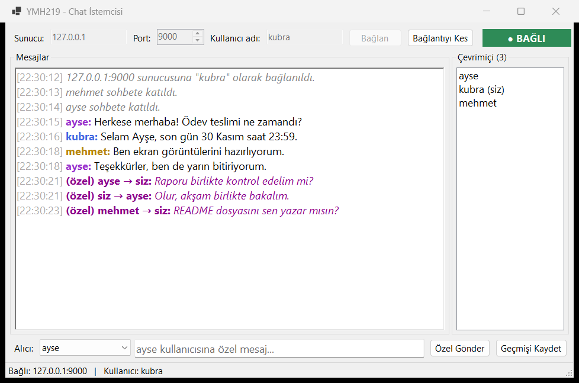
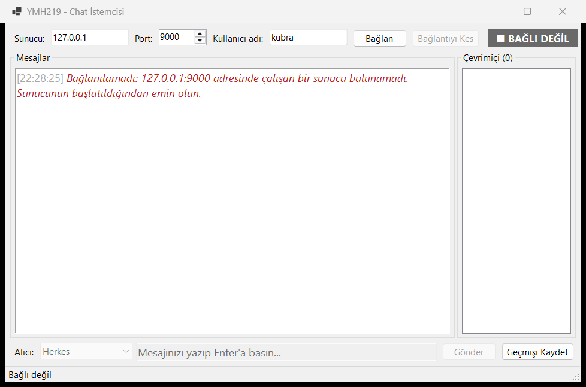

# YMH219 - Chat Uygulaması

Nesne Tabanlı Programlama (YMH 219) dersi için C# ve Windows Forms ile yazılmış istemci-sunucu sohbet uygulaması. Sunucu `TcpListener`, istemci `TcpClient` kullanır. Aynı bilgisayarda veya yerel ağda çalışır.

## Özellikler

- Sunucu: dinlemeyi başlat/durdur, bağlı istemci listesi, günlük
- İstemci: bağlan/kes, genel mesaj, çevrimiçi kullanıcı listesi
- Özel mesaj (alıcı seçimi)
- Mesaj geçmişini `.txt` dosyasına kaydetme
- Kullanıcı adı kuralları ve bağlantı hatalarında uyarı

## Kullanılan teknolojiler

- C# / .NET 9, Windows Forms
- `TcpListener` / `TcpClient`
- `StreamReader` / `StreamWriter`
- `System.Text.Json` (satır bazlı JSON mesajlar)

## Proje yapısı

```
YMH219-ChatApp/
├── ChatApp.Core/     Ağ ve mesaj mantığı
├── ChatApp.Server/   Sunucu arayüzü
├── ChatApp.Client/   İstemci arayüzü
└── docs/screenshots/
```

## Çalıştırma

```bash
git clone https://github.com/kubradmrgc/YMH219-ChatApp.git
cd YMH219-ChatApp
dotnet run --project ChatApp.Server
```

Başka bir terminalde:

```bash
dotnet run --project ChatApp.Client
```

Aynı bilgisayarda sunucu adresi `127.0.0.1`, varsayılan port `9000`. Yerel ağda sunucu durum çubuğundaki IP’yi kullanın.

## Ekran görüntüleri






## Sınırlamalar

- Mesajlar şifresizdir; yalnızca güvenilir yerel ağ için uygundur.
- Parola yoktur; tek ortak oda vardır.
- Sunucu mesaj geçmişi tutmaz.

## Öğrenci

- Ad Soyad: Kübra Demirgüç
- Öğrenci No: 230541115
